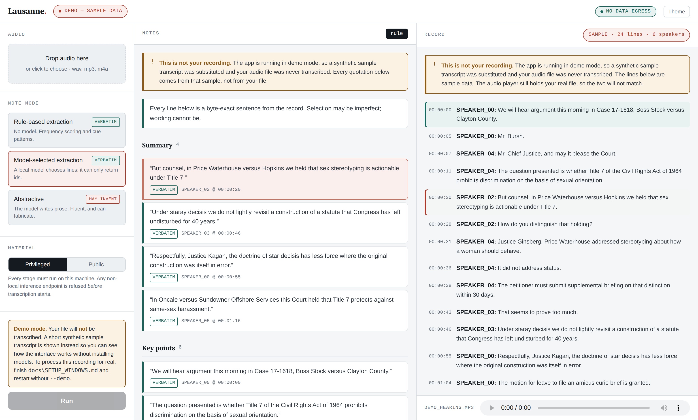

# Lausanne

A fully local, API-free pipeline that turns legal proceeding audio into
speaker-attributed, timestamped, **citation-backed** notes — and an evaluation
harness that measures whether it actually works.

Nothing leaves the machine. Transcription, diarization, and note generation all
run on-device, which for privileged legal audio is not a nice-to-have but the
condition of using the tool at all.

Built for a consumer laptop: RTX 4060 (8 GB VRAM), 16 GB system RAM.

> **On the name.** *Lausanne* refers to the research collaboration this work
> was carried out in connection with. It is not a product of, endorsed by, or
> affiliated with the University of Lausanne or HEC Lausanne; the work and any
> errors in it are the author's own.

[](https://github.com/AadityaK21/lausanne/actions/workflows/ci.yml)
[](LICENSE)
[](https://www.python.org/)

---

## Try it in one command, with no models installed

```bash
python app/server.py --demo
```

Opens the application at `http://127.0.0.1:7842`. Demo mode replaces only the
two GPU stages with fixtures — merge, extraction, and rendering are the
production code paths — so you can see how the tool behaves before committing
to a CUDA install.



**The interface has one idea in it.** Every note line is a button. Click it and
the transcript scrolls to the sentence it came from, highlights it, and the
audio player seeks to that moment in the recording. Verifying a claim against
the record is one click rather than a Ctrl+F and a scrub.

That is the whole argument of the project made operable. A note is only as
useful as the ease of checking it, and a citation you have to chase is a
citation nobody checks.

The server binds loopback and **refuses to bind anything else** — a tool whose
premise is that privileged audio stays on one machine must not be one mistyped
flag away from serving it to a network.

---

## What makes it different

Most local meeting-notes tools are a Whisper wrapper feeding a prompt to a
local LLM. That gets you fluent notes and inherits every hallucination problem
the model has — which, for a document that may be relied on as an account of
what a court said, is the whole problem.

This pipeline offers three note modes that differ in **where the output text
comes from**:

| Mode | Selection by | Text originates from | Can it fabricate? |
|---|---|---|---|
| `extractive-rule` | Word frequency + regex cues | Transcript | No — structurally |
| `extractive-llm` | Local LLM, **ids only** | Transcript | No — structurally |
| `abstractive` | Local LLM | The model | Yes |

The middle one is the interesting one. The model reads a numbered transcript
and returns *only integer utterance ids* — its response schema, enforced at
decode time by the inference engine's grammar constraint, contains no free-text
field for claims. The note text is then re-materialised from the transcript by
id lookup.

So the selection is as good as an 8B model's judgement, while the wording is
byte-exact source. Not "we told the model not to hallucinate" — the model has
no channel through which to.

Every note line carries a citation back into the record (`speaker @ HH:MM:SS`),
and the renderer visually distinguishes quotations from paraphrase, so a reader
always knows which parts of the document are the record and which are a model's
account of it.

---

## Quick start

```powershell
python run.py doctor                              # check the environment
python tests\test_pipeline.py                     # 187 offline checks, ~2s
python src\eval\fetch_oyez.py --term 2019 --limit 2   # public gold audio

# privileged by default: refuses any non-local inference endpoint
python run.py data\audio\hearing.mp3 --mode all
# public material may use the hosted tier
python run.py data\audio\2019_17-1618.mp3 --mode all --material public --tier hosted

python run.py --verify work\hearing               # re-check a run's attestation
python src\eval\report.py --gold data\gold --work work
```

Full install: **[docs/SETUP_WINDOWS.md](docs/SETUP_WINDOWS.md)**.

---

## Architecture

```
audio ──► asr.py ──────► transcript.json ─┐
                                          ├─► merge.py ──► merged.json ──┐
audio ──► diarize.py ──► speakers.json ───┘                              │
                                                                         │
        ┌────────────────────────────────────────────────────────────────┘
        │
        ├─► extract.py    (rule-based, no model)  ──► notes_*.json ──► render.py
        └─► summarize.py  (extractive-llm | abstractive)                  │
                                                                         ▼
                                              notes.md · notes.docx · transcript.txt
```

Each stage is a **separate process** that reads JSON, works, writes JSON, and
exits. `run.py` never imports torch or any CUDA-linked library — it only
sequences subprocesses.

That is not architectural taste. The three stages need 12 GB of VRAM combined
against ~7.3 GB usable, and PyTorch does not reliably return CUDA memory
in-process while Ollama will happily keep 5.2 GB resident between calls. On
Windows, exceeding VRAM does not raise — the driver silently spills to shared
system memory and the pipeline runs ~50× slower with no error anywhere. Process
exit is the only eviction primitive that actually works. Details in
**[docs/MEMORY.md](docs/MEMORY.md)**.

Free side effects: crash recovery (every intermediate is on disk, so a failure
in the LLM stage does not cost you the eight minutes of ASR before it) and
independent testability of every stage.

---

## Evaluation

The point of the harness is that "it produces nice-looking notes" is not a
result. What it measures:

| Metric | Gold source | Module |
|---|---|---|
| Word error rate | Oyez official transcripts | `src/eval/wer.py` |
| **Legal-term WER** | same, restricted to load-bearing tokens | `src/eval/wer.py` |
| Diarization error rate | Oyez per-turn speaker labels | `src/eval/der.py` |
| Verbatim rate | the transcript itself — no model needed | `src/eval/judge.py` |
| Claim support (abstractive) | checklist LLM-as-a-Judge | `src/eval/judge.py` |
| Judge injection susceptibility | planted attacks | `src/eval/judge.py --injection-test` |
| Judge abstention rate | panel disagreement | `src/eval/judge.py` |
| **Speaker-label bias** | the transcript, relabelled | `src/eval/bias.py` |
| Action item / decision P/R | expert annotation | `src/eval/extraction_pr.py` |
| Content coverage, temporal spread | computed | `src/eval/report.py` |

Three of these are worth calling out.

**Legal-term WER.** Overall WER on courtroom audio looks reassuring — single
digits. The error rate restricted to case names, citations, statutory
references, and Latin terms is several times higher, and those are exactly the
tokens a lawyer would cite. A system can score 6% WER while mangling every case
name. Table 1 reports both and the ratio between them.

**The verbatim check needs no model.** Before any judge is invoked, every claim
is tested for byte-exact membership in the transcript. For the extractive modes
that settles faithfulness entirely, with zero inference and zero judge error —
and any non-verbatim claim there is a bug in the pipeline, not a model failure.
The judge is only ever asked about abstractive output, which is the only place
its own unreliability can matter.

The judge follows CheckEval: atomic yes/no items rather than a 1–5 score,
because pointwise Likert scoring is poorly calibrated and prompt-sensitive.
It defaults to a different model family than the generator, fences evaluated
content in a delimiter with an explicit instruction hierarchy, and
`--injection-test` plants prompt-injection attacks in the evaluated text to
measure whether that defence actually holds — an unmeasured defence being an
assumption.

It is also allowed to say *I don't know*. Self-consistency voting damps prompt
sensitivity but throws away the size of the majority: a 3–0 verdict and a 2–1
verdict come out of the vote indistinguishable, and everything downstream then
treats them as equally established. Every checklist item carries the fraction
of the panel that agreed, and a claim whose verdict rests on a split panel is
recorded as **undecided** rather than resolved by one sample. The asymmetry is
deliberate — a claim fails on one *stably* false item and passes only when
every item passes stably, so abstention can never soften a failure into a pass.
Both denominators are reported: `support_rate` counts abstentions against the
system, `support_rate_decided` excludes them, side by side so a judge that
declines every hard case cannot post a flattering score unobserved.

**Whether the notes are even-handed, not just correct.** Every metric above
asks whether the notes are accurate. None asks whether they are fair. A note
set that quotes the bench flawlessly and drops counsel's strongest point scores
100% verbatim, passes every checklist item, and shows no WER or DER error — and
is still a bad set of notes.

`src/eval/bias.py` asks the other question. A transcript can be relabelled
without changing a byte of what was said, so selection is re-run over
transcripts whose text is identical and whose speaker labels have been
anonymised, and separately permuted so the same labels sit on different people.
Any difference in what gets selected is caused by the labels.

```bash
python run.py hearing.wav --mode extractive-llm --bias-probe
python src/eval/bias.py --merged work/hearing/merged.json --out work/hearing/bias.json
```

The control condition is the part that makes it a measurement rather than a
number. Two identical runs do not return the same selection, so a `control` run
with the labels untouched is measured alongside, and nothing counts as evidence
unless it exceeds what resampling alone produced — a noisy control *raises* the
bar rather than lowering it. The verdict is gated on movement in the
per-speaker distribution, not on set overlap, because a selector can swap out
half its sentences while leaving every speaker's share intact; that is
instability, not bias, and conflating the two would manufacture findings.

Gold data comes from [Oyez](https://www.oyez.org) (CC-BY-NC): US Supreme Court
oral argument audio aligned to official transcripts, with per-turn speaker
attribution. Real legal speech, public, so the high-resource tier can be
benchmarked without any privileged material touching rented hardware.

> SCOTUS oral argument is a *floor*, not a representative sample: recording
> quality is unusually good and the speakers unusually articulate. Depositions
> and trial-court audio will be worse.

---

## Confidentiality is demonstrated, not asserted

Running locally is necessary for the confidentiality claim and not sufficient,
because the claim has to survive being questioned — by a supervising partner, an
opposing party, or a client.

Every run emits a manifest recording a SHA-256 of the input, the model and
execution endpoint of every stage, hashes of all artefacts produced, and a
classification of each network endpoint contacted that separates **data egress**
(run content sent off-host) from **asset retrieval** (weights fetched).

That separation is the part most easily got wrong. Downloading Whisper's weights
is outbound traffic that discloses nothing about the proceeding; sending a
transcript to a hosted endpoint discloses everything. A record that reports both
as "network activity" teaches its reader to ignore it.

The classification is enforced, not documented. A run is `privileged` by default
and will refuse — before any inference happens — to execute against a
non-loopback endpoint:

```
Refusing to run tier 'hosted' against endpoint 'https://rented-gpu:11434'.
This run is classified as PRIVILEGED, and that endpoint is not on this host.
```

`run.py --verify <run>` re-checks a manifest against the files on disk. It
answers a narrow question honestly — do the artefacts still hash to what the
manifest says — and does not pretend to be a network capture.

---

## Design principles

The artefact is the instantiation of thirteen design principles, stated in the
Chandra et al. (2015) template and positioned against Herath et al. (2026),
who derive principles for text-to-image CSTs in visual design. Five have no
analogue there: three follow from confidentiality, one from the fact that legal
documents circulate beyond their author, and one from the fact that the input
is speech attributed to parties whose interests oppose one another.

See **[docs/DESIGN_PRINCIPLES.md](docs/DESIGN_PRINCIPLES.md)** and
**[docs/SECTION_8_REWRITE.md](docs/SECTION_8_REWRITE.md)**.

`tests/test_pipeline.py` asserts the properties those principles claim, so a
regression breaks them loudly rather than silently.

---

## Two tiers

| Tier | Model | Hardware | Use |
|---|---|---|---|
| `local` | 8B-class, Q4_K_M (~5.2 GB) | RTX 4060, 8 GB | Everything, including privileged audio |
| `hosted` | 70B-class, Q4_K_M (~43 GB) | rented L40S / A100 | **Public court audio only** |

The tier is recorded on every artifact and reported as a separate row. Pointing
the hosted tier at privileged material would void the confidentiality property
the whole system exists for — so the pipeline refuses to, rather than trusting
you to remember at 2am.

---

## Layout

```
app/server.py             local application server (standard library only)
app/static/index.html     the interface (single file, no build step)
run.py                    orchestrator + `doctor` environment check
config.yaml               all tunables
src/schemas.py            stage contracts (Pydantic) — the wire format
src/config.py             config loading, tier definitions, VRAM budget
src/util/                 io, logging, gpu, ollama client, provenance, legal text normalisation
src/stages/               asr · diarize · merge · extract · summarize · render
src/eval/                 fetch_oyez · wer · der · judge · bias · extraction_pr · report
prompts/                  editable prompt templates
tests/test_pipeline.py    187 offline checks, no GPU, no network
tests/test_app.py         32 checks against a live server, no models
docs/                     SETUP_WINDOWS · MEMORY · DESIGN_PRINCIPLES
                          SECTION_8_REWRITE · PAPER_REVISION_NOTES
```

---

## Context

Implementation of the prototype described in §8 of *NLP and Large Language
Models for Legal AI: A Survey of Methods, Benchmarks, Reliability, and a
Note-Generation Prototype* (Aaditya Kumawat, IIT Delhi; in connection with a
research collaboration at the Applied Artificial Intelligence Laboratory,
HEC Lausanne, University of Lausanne).

§8.4 of that draft states the prototype "has not been evaluated on legal audio,
and no quantitative accuracy claims are made here." This repository is the
work that closes that gap — plus one addition the draft does not contain
(model-selected extraction) and one correction it needs (the 70B claim).
See **[docs/PAPER_REVISION_NOTES.md](docs/PAPER_REVISION_NOTES.md)**.

---

## Limitations

- **Extraction guarantees faithfulness to the transcript, not to the
  proceeding.** If ASR mishears the case name, a perfectly faithful extractive
  summary will quote it wrong. This is the failure mode that sits *upstream* of
  the hallucination literature, and legal-term WER is how it gets measured.
- Action-item and decision P/R require human annotation. The harness generates
  a template and refuses to print zeros until it is filled in.
- English only as configured. The Indian-jurisdiction thread in the survey
  (ILDC, NyayaAnumana) would need native audio, native ASR evaluation, and
  cue patterns rewritten for Indian court practice.
- File input only; live capture is not implemented.
- Not legal advice, and not a substitute for the record.
